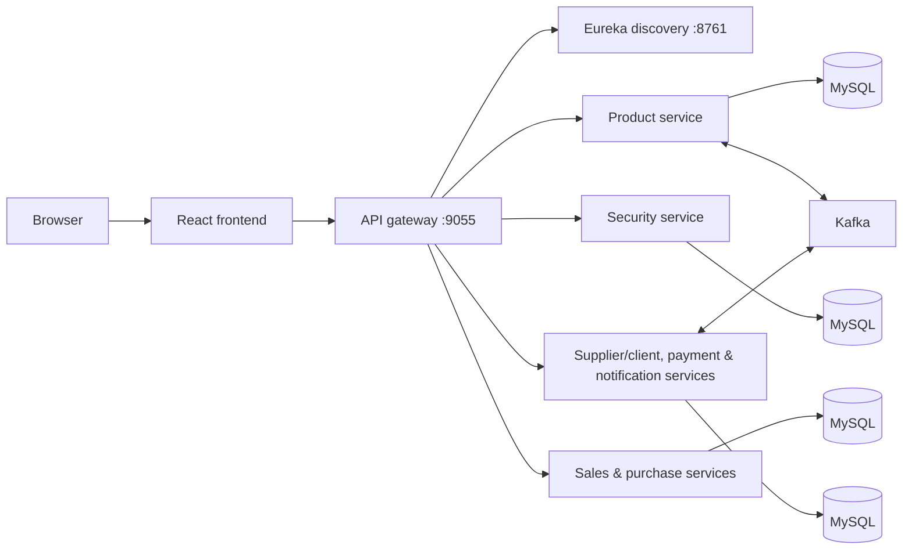

# PFEL Commerce Platform

An academic e-commerce and store-management platform for managing products, suppliers and clients, purchase and sales flows, payments, user access, and operational notifications. It consolidates the most complete frontend and backend implementations into one repository with a single configuration and build entry point.

## Implemented features

- Product catalogue, stock-level, and expiry tracking
- Supplier and client management
- Purchase orders/invoices and sales orders/invoices
- Payment and paid-date tracking
- Authentication, roles, permissions, and activity logging
- Notification APIs and WebSocket delivery hooks
- API routing through a gateway with service discovery

## Technology stack

- Frontend: React, TypeScript, Create React App, React Router, Material UI, Bootstrap, Chart.js, i18next
- Backend: Java 17, Spring Boot, Spring Cloud Gateway, Eureka, Spring Data JPA, Spring Security, OpenFeign
- Data and messaging: MySQL, Apache Kafka, WebSocket/STOMP
- Tooling: Maven Wrapper, npm, Docker Compose, GitHub Actions

## Architecture



## Repository structure

```text
frontend/                    React client
backend/
  api-gateway/               Public API entry point
  discovery-server/          Eureka service registry
  shared-model/              Shared notification/domain model library
  security-core/             Shared security library
  *-service/                 Business microservices
.github/workflows/           CI verification
docker-compose.yml           Local infrastructure and service orchestration
```

## Local setup

Prerequisites: JDK 17+, Node.js 22+, and npm. Docker Desktop is required only for the containerized stack.

Build and verify the backend:

```powershell
.\mvnw.cmd verify
```

On macOS/Linux, use `./mvnw verify`.

Start the frontend:

```powershell
Set-Location frontend
Copy-Item .env.example .env
npm ci
npm start
```

The frontend runs on port `3003` and, by default, sends API requests to the gateway at `http://localhost:9055`.

## Docker

Copy the safe template, replace its placeholders with local development values, then start the stack:

```powershell
Copy-Item .env.example .env
docker compose up --build
```

The Compose file starts MySQL instances, Kafka, the discovery server, gateway, and the backend services. Never commit `.env` files.

## Configuration

Root [`.env.example`](.env.example) documents the database, JWT, email, and frontend variables required by Docker Compose. The frontend has its own [`frontend/.env.example`](frontend/.env.example) for its browser-exposed gateway URL.

All backend settings use environment-variable overrides with development-only defaults. Configure real passwords, mail credentials, and JWT secrets only in an ignored local `.env` file or a deployment secret store.

## Verification

```powershell
.\mvnw.cmd verify
Set-Location frontend
npm ci
npm run build
```

CI runs the same backend verification and frontend production build on pushes and pull requests to `main`.

## Current limitations

- The application is a consolidated PFE/academic project, not a production deployment.
- The automated backend tests are primarily Spring context-load tests; business-flow integration coverage remains limited.
- Email delivery, Kafka processing, and complete end-to-end workflows require the local infrastructure and credentials supplied by the operator.
- Some frontend dependencies inherited from the academic implementation report upstream deprecation warnings and should be modernized incrementally.

## Future improvements

- Add API contract and end-to-end tests for each gateway route.
- Consolidate service dependency versions through a shared Maven parent.
- Add database migrations and hardened production profiles.
- Replace legacy Create React App tooling with a maintained frontend build tool.

## Contributors

Original development and consolidation: Anass Eraoui. Historical Git metadata used multiple identity labels for the same recorded email address; no separate collaborator attribution could be verified from the available repository history.
